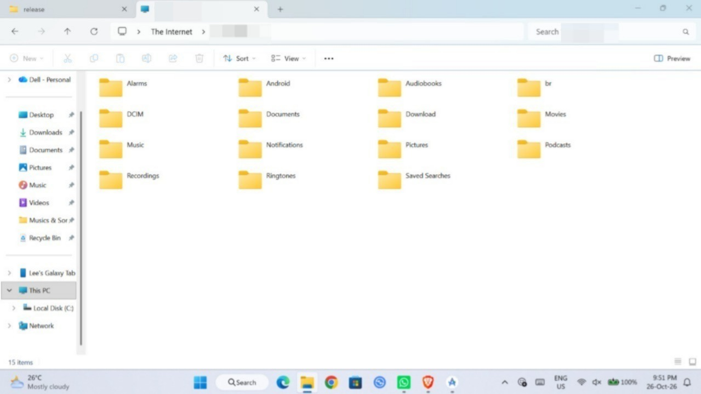
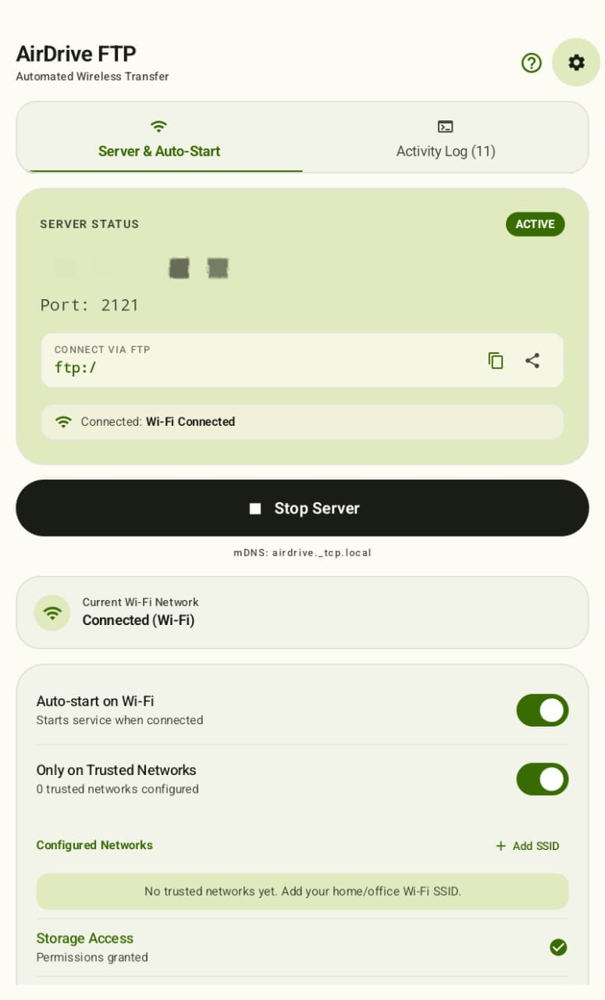

# Ambient Airdrive FTP
A next gen high speed (100 MBps+) wireless file transfer protocol from phone to laptop / tablet. 

## 📖 Features

* Ultra-High Speed
* Seamless Wireless Transfer
* Stable and quick connection
* Easy to setup
* Lightweight, ~18MB only!
* Fast Speed
* Zero Ads & Zero Tracking
* 100% Unlimited free usage

## ⚠️ Requirements

* Android 10.0+

## 📷 Screenshots

## ☕ Support

If you like this project, kindly star this repo as basic support to help keep it alive!

## 💬 Join My Discord Server

Join my discord server at <a href="https://discord.gg/ATnXUUnS">
  Click Here To Join my Discord server
</a>! 

## 🔨 Contributing

Pull requests are strongly recommended. For major changes, please open an issue first to discuss what you would like to change.

## 🌎 Translations

You can help translate Airdrive FTP by using this repo codes. 

## 📜 License

This project is licensed under [GPL-v3 License](/LICENSE)
